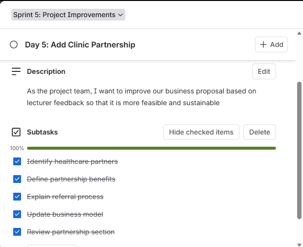
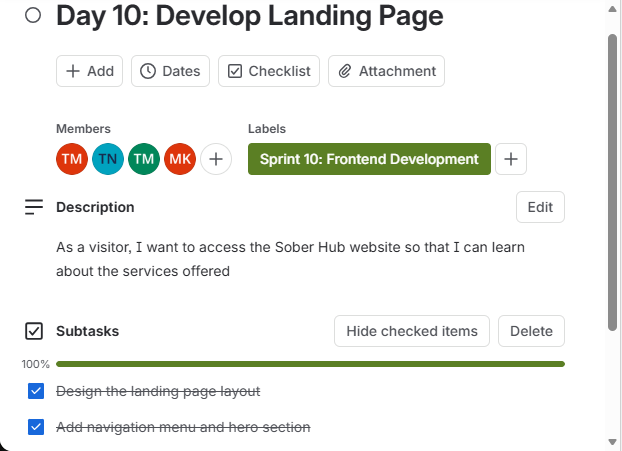
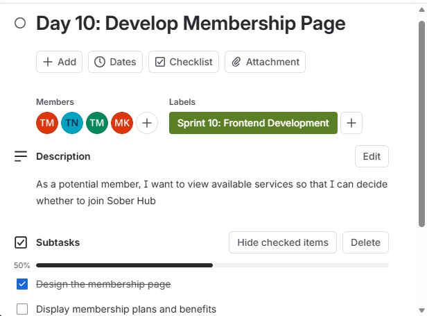
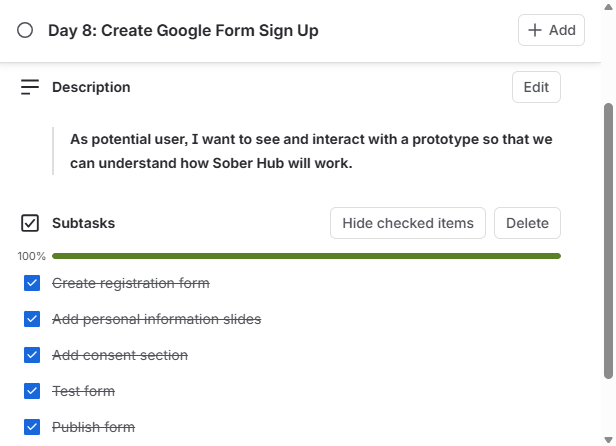
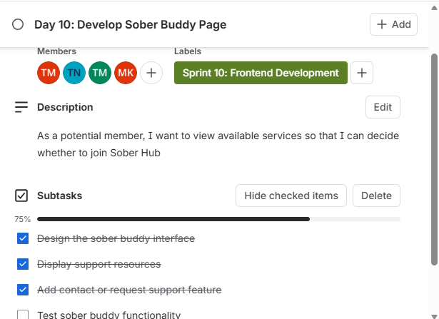
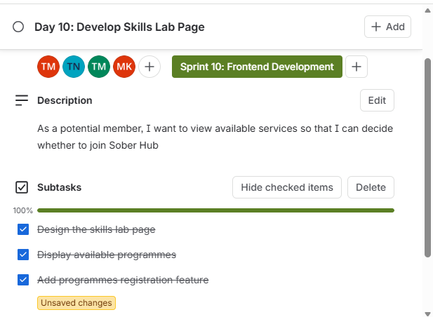
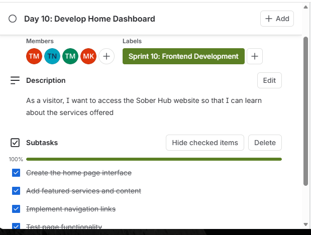
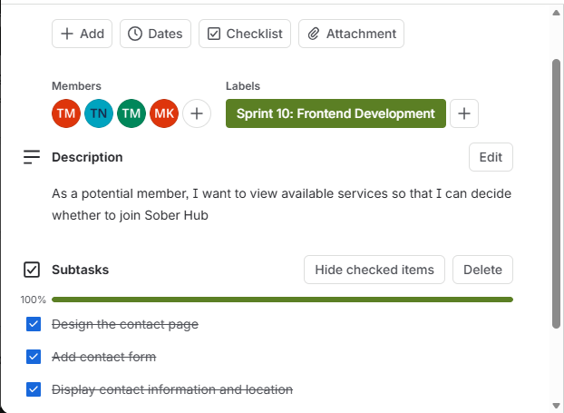

</>Markdown

# Moltinate230074189.github.io

#  💼 Tsebo Moltinate Motsumi
### ICT Application Development Student

Welcome to my digital portfolio showcasing my skills, projects,and work readiness training.

📍 Cape Town, South Africa
📧 230074189@mycput.ac.za
🔗 [LinkedIn](https://www.linkedin.com/in/tsebo-moltinate-motsumi-ab532a285)  
🐙 [Github] (https://github.com/Moltinate230074189)

---

##  🎯  Objective
Dedicated and enthusiastic ICT Application Development student seeking an IT Internship to apply strong foundations in software development, problem solving, and UI/UX design. Passionate about building innovative technology solutions, learning in a professional environment, and contributing to impactful IT projects.

---
## 🎓  Education
**Mophate Secondary School**
-National Senior Certificate (Grade 12) | 2021

**Cape Peninsula University of Technology**
-Higher Certificate in ICT (Completed) - November 2023
-Diploma in ICT (Current)

---
## 🛠️ Technical Skills
-Java Programming Fundamentals
-Web Development (HTML, CSS, JavaScript)
-Database Concepts and Design
-Problem Solving
-UI/UX Design (Figma)

---
##  💼 Experience
**Cashier**
*MM Makoatsane Services and Bottle Store* (1 Year)
-Provided excellent customer service
-Handled transactions accurately
-Assisted with stock control
-Improved communication and interpersona skills

---
## 🚀 Projects

- **Study Group Finder App (Java)**  
  UI/UX Designer in a group development project  
- **Fitness App Design**  
  Created user stories, diagrams, and interface designs  
- **Digital Interface Redesign**  
  Applied usability principles using Figma  
---

## 📞 References
**Ralebeko Maine**
Mophate Secondary School
📧 83794590@fsschoolportal.gov.za

**Adam Mabaso**
Peace Makers Church (Bothaville Branch)

---
## 📝 Reflection on Coding in Markdown (STAR Method)
**Situation:**
I was required to design my CV using markdown on GitHub as part of my portfolio assignment.

**Task:**
My task was to learn Markdown syntax and present my CV in a clean, structured, and professional format.

**Action:**
I researched Markdown formatting and also used the instructions I got from the study guide, used headings, lists and links to structure my CV, and ensured it was easy to read on GitHub.

**Result:**
I successfully created a well-organized CV that is visually appealing and accessible online. I also improved my documentation and formatting skills.

---

## 🎥Mock Interview
[Watch my mock interview video here](./Mock_Interview_Video.mp4)

---
## 🎥 Reflection on Mock Interview (STAR Method)
**Situation:**
I participated in a mock interview to prepare for real-world job opportunies.

**Task:**
My task was to present myself professionally, answer questions confidently, and demonstrate my skills.

**Action:**
I prepared answers, practiced communication skills, and recorded the interview video.

**Result:**
I improved my confidence, communication, and ability to present myself professionally. I also identified areas where I can improve.

---

## 🌐 Reflection on GitHub Pages (STAR Method)
**Situation:**
I was required to publish my portfolio using GitHub Pages.

**Task:**
My task was to deploy my repository and ensure it is accessible online.

**Action:**
I configured GitHub Pages settings, deploy my README file, and tested the live link.

**Result:**
I successfully published my portfolio online and gained experience in hosting web content using GitHub Pages.

---

# 🚀 Agile Project Portfolio: Sober Hub
## Module: Project Presentation | Role: Team Leader and Presenter | Project: Sober Hub (youth recovery support in Katlehong)

About the project: Sober Hub is a business idea that gives young people in Katlehong who are recovering from substance abuse a safe space, peer mentorship, skills development and WhatsApp-based support. My team and I worked on it using Agile (Scrum and Kanban) from research and wireframes to a working website prototype on GitHub Pages.

**Live prototype:**
https://sober-hub-project.vercel.app/

**Trello Board:** 
https://trello.com/b/BmXaw4Vp/sober-hub-project-agile-scrum-board
---

## 1. Agile Team Charter

**Introduction:**
An Agile team charter is a shared agreement that sets out the team's purpose, roles, working rules, communication and Definition of Done. I included it because it is the foundation of how out team planned to work together on Sober Hub.

The following evidence demonstrates the development of our Agile Team Charter.

### Team Charter Document

[View Team Charter PDF](Agile_Team_Charter/Sober_Hub_Agile_Team_Charter_v2.pdf)

<h3>Team Charter Screenshots</h3>

<table>
  <tr>
    <td align="center" width="50%">
      
       
      <strong>Evidence 1</strong>
    </td>
    <td align="center" width="50%">
      
       
      <strong>Evidence 2</strong>
    </td>
  </tr>
  <tr>
    <td align="center" width="50%">
      
       
      <strong>Evidence 3</strong>
    </td>
    <td align="center" width="50%">
      
       
      <strong>Evidence 4</strong>
    </td>
  </tr>
  <tr>
    <td align="center" width="50%">
      
       
      <strong>Evidence 5</strong>
    </td>
    <td align="center" width="50%">
      
       
      <strong>Evidence 6</strong>
    </td>
  </tr>
  <tr>
    <td align="center" width="50%">
      
       
      <strong>Evidence 7</strong>
    </td>
    <td align="center" width="50%">
      
       
      <strong>Evidence 8</strong>
    </td>
  </tr>
  <tr>
    <td align="center" width="50%">
      
       
      <strong>Evidence 9</strong>
    </td>
    <td align="center" width="50%">
      
       
      <strong>Evidence 10</strong>
    </td>
  </tr>
  <tr>
    <td align="center" width="50%">
      
       
      <strong>Evidence 11</strong>
    </td>
    <td align="center" width="50%">
      <!-- Leave this cell empty -->
    </td>
  </tr>
</table>

## Reflection on Agile Team Charter
**Situation:**
We created the first charter on 1st May 2026 so the group would have agreed rules for the Sober Hub project. Later, a new member asked to join, and my logbook showed that the original charter was not solving some real problems.

**Task:**
As a Team Leader, I had to make sure the charter matched how we actually worked and could include new members.

**Action:**
I reviewed Version 1.0 against my logbook entries. I found gaps; some roles had no names, the framework said Kanban although we used a Scrum board, and there was nothing about missed messages or uneven participation. In Version 2.0 I confirmed Scrum + Kanban, updated the roles, added response times, an announcemnet rule, an attendance rule, an accountability process, an onboarding checklist for new members and a stronger Definition of Done for documents, design and code.

**Result:**
The charter is now a living document with a version history that new member can sign. the new member approved of it and the Version 2.0 is better and livelier than the first version. 

**Learning:**
I learnt that a charter only works if it is revisited and applied, not written once and filed away. I also learnt that clear communication rules protect the team when workloads are uneven. net time I would hold a short charter review in the first week of every project and check it again at each retrospective.

**How this connects to sober Hub:**
Sober Hub is about trust, safety and consistent support for young people. a team that wants to build that kind of service must itself be reliable, respectful and accountable. The charter's values (respect, transparency, accountability, trust) are the same values Sober Hub promises its users.

---

## 2. User Stories and Tasks

**Introduction:**
A user story describes a feature from the end user's point of view ("As a ..., I want ..., so that ..."). Each story is then broken into smaller tasks the team can complete and tick off. I include this section to show how the Sober Hub idea was turned into work the team could build and track.

The following evidence demonstrates the development of our User Stories and Tasks.

<h3>User Stories and Tasks Screenshots</h3>

<table>
  <tr>
    <td align="center" width="50%">
      
       <strong>Evidence 1</strong>
    </td>
    <td align="center" width="50%">
      
       <strong>Evidence 2</strong>
    </td>
  </tr>
  <tr>
    <td align="center" width="50%">
      
       <strong>Evidence 3</strong>
    </td>
    <td align="center" width="50%">
      
       <strong>Evidence 4</strong>
    </td>
  </tr>
  <tr>
    <td align="center" width="50%">
      
       <strong>Evidence 5</strong>
    </td>
    <td align="center" width="50%">
      
       <strong>Evidence 6</strong>
    </td>
  </tr>
  <tr>
    <td align="center" width="50%">
      
       <strong>Evidence 7</strong>
    </td>
    <td align="center" width="50%">
      
       <strong>Evidence 8</strong>
    </td>
  </tr>
  <tr>
    <td align="center" width="50%">
      
       <strong>Evidence 9</strong>
    </td>
    <td align="center" width="50%">
      
       <strong>Evidence 10</strong>
    </td>
  </tr>
  <tr>
    <td align="center" width="50%">
      
       <strong>Evidence 11</strong>
    </td>
    <td align="center" width="50%">
      
       <strong>Evidence 12</strong>
    </td>
  </tr>
</table>

## Reflection on User Stories and Tasks
**Situation:**
After the lecturer approved our business idea, we had to turn Sober Hub into something we could design and build, working in short sprints on Trello.

**Task:**
I needed to describe what our users (young people in recovery, parents and community members) need, and then spilt that into small tasks the team could finish and tick off.

**Action:**
We organised the work into cards with checklists, for example the survey cards in Sprint 2 and the website page cards in Sprint 10 (Landing Page, Membership, Sober Buddy, Skills Labb, Contact, Dashboard and Responsive Design). I wrote the user stories to explain why each page exists, not only what to build. Along the way we changed approach when the lecturer advised moving the wireframes from HTML to Figma.

**Result:**
Sprints 1 to 3, 5-9 were completed with all the checklist items ticked, and the website was presented on 4 August 2026.

**Learning:**
I learnt that a task list alone does not explain who the feature is for; the user story keeps the design focused on the person using it. I also noticed that every card on our board is assigned to all four members, which makes it hard to see who did what. next time I would assign each card or checklist item to one named owner and add acceptance criteria to every story but since Trello needed me to pay for that member assign task next time I will be more prepared and adhere to every rule.

**How this connects to Sober Hub:**
Our users are vulnerable young people, so every page has to be simple, welcoming and easy to use on a phone. Writing stories from their point of view, such as the Sober Buddy support story, kept the design focused on their needs.

## 3. Product Backlog

**Introduction:**
The Product backlog is the ordered list of everything still to be build or improved. it changes whenever feedback arrives. I include it to show what remained to be done and how our priorities evolved.

The following evidence demonstrates the development of our Product Backlog.

<h3>Product Backlog Evidence</h3>

  
  

