</>Markdown

# Moltinate230074189.github.io

#  💼 Tsebo Moltinate Motsumi
### ICT Application Development Student

Welcome to my digital portfolio showcasing my skills, projects,and work readiness training.

📍 Cape Town, South Africa
📧 230074189@mycput.ac.za
🔗 [LinkedIn](https://www.linkedin.com/in/tsebo-moltinate-motsumi-ab532a285)  
🐙 [Github] (https://github.com/Moltinate230074189)

---

##  🎯  Career Objective
I am an ICT Application Development student at Cape Peninsula
University of Technology seeking an IT internship where I can
apply my programming, web development, database and UI/UX skills.
I am eager to gain practical industry experience, contribute to
real projects and continue developing as a technology professional.
---
## 🎓  Education
**Mophate Secondary School**
-National Senior Certificate (Grade 12) | 2021

**Cape Peninsula University of Technology**
-Higher Certificate in ICT (Completed) - November 2023
-Diploma in ICT (Current)

---
## 🛠️ Technical Skills
- **Programming:** Java fundamentals
- **Web Development:** HTML, CSS, JavaScript
- **Databases:** Database concepts, design and SQL fundamentals
- **UI/UX Design:** Figma and interface design
- **Development Practices:** Git, GitHub and problem-solving
---
##  💼 Work Experience

**Cashier — MM Makoatsane Services and Bottle Store**  
*Duration: 7 months*

- Assisted customers and provided friendly service.
- Processed transactions and handled payments accurately.
- Assisted with stock control and general store operations.
- Developed communication, teamwork and problem-solving skills.
---

## 🚀 Projects

- **Study Group Finder App (Java)**  
  UI/UX Designer in a group development project  
- **Fitness App Design**  
  Created user stories, diagrams, and interface designs  
- **Digital Interface Redesign**  
  Applied usability principles using Figma  
---

## 📞 References
**Ralebeko Maine**
Mophate Secondary School
📧 83794590@fsschoolportal.gov.za

**Adam Mabaso**
Peace Makers Church (Bothaville Branch)

---
## 📝 Reflection on Coding in Markdown (STAR Method)
**Situation:**
I was required to design my CV using markdown on GitHub as part of my portfolio assignment.

**Task:**
My task was to learn Markdown syntax and present my CV in a clean, structured, and professional format.

**Action:**
I researched Markdown formatting and also used the instructions I got from the study guide, used headings, lists and links to structure my CV, and ensured it was easy to read on GitHub.

**Result:**
I successfully created a well-organized CV that is visually appealing and accessible online. I also improved my documentation and formatting skills.

---

## 🎥Mock Interview
[Watch my mock interview video here](./Mock_Interview_Video.mp4)

---
## 🎥 Reflection on Mock Interview (STAR Method)
**Situation:**
I participated in a mock interview to prepare for real-world job opportunies.

**Task:**
My task was to present myself professionally, answer questions confidently, and demonstrate my skills.

**Action:**
I prepared answers, practiced communication skills, and recorded the interview video.

**Result:**
I improved my confidence, communication, and ability to present myself professionally. I also identified areas where I can improve.

---

## 🌐 Reflection on GitHub Pages (STAR Method)
**Situation:**
I was required to publish my portfolio using GitHub Pages.

**Task:**
My task was to deploy my repository and ensure it is accessible online.

**Action:**
I configured GitHub Pages settings, deploy my README file, and tested the live link.

**Result:**
I successfully published my portfolio online and gained experience in hosting web content using GitHub Pages.

---

# 🚀 Agile Project Portfolio: Sober Hub
## Module: Project Presentation | Role: Team Leader and Presenter | Project: Sober Hub (youth recovery support in Katlehong)

## About the project 
Sober Hub is a business idea that gives young people in Katlehong who are recovering from substance abuse a safe space, peer mentorship, skills development and WhatsApp-based support. My team and I worked on it using Agile (Scrum and Kanban) from research and wireframes to a working website prototype on GitHub Pages.

**Live prototype:**
https://moltinate230074189.github.io/SoberHub2/

**Trello Board:** 
https://trello.com/b/BmXaw4Vp/sober-hub-project-agile-scrum-board
---

## 1. Agile Team Charter
## Introduction
An Agile team charter is a shared agreement that sets out the team's purpose, roles, working rules, communication and Definition of Done. I included it because it is the foundation of how out team planned to work together on Sober Hub.

  The following screenshots provide evidence of the Agile Team
  Charter and its supporting sections. The charter establishes
  team responsibilities, communication practices, working
  agreements and expectations for project delivery.

<table>
  <tr>
    <td width="50%" align="center">
      
      
<strong>Evidence 1</strong> Team Charter

    </td>
    <td width="50%" align="center">
      
      
<strong>Evidence 2</strong> Team Charter supporting section

    </td>
  </tr>
  <tr>
    <td width="50%" align="center">
      
      
<strong>Evidence 3</strong> Team agreements

    </td>
    <td width="50%" align="center">
      
      
<strong>Evidence 4</strong> Team responsibilities

    </td>
  </tr>
  <tr>
    <td width="50%" align="center">
      
      
<strong>Evidence 5</strong> Working practices

    </td>
    <td width="50%" align="center">
      
      
<strong>Evidence 6</strong> Communication and collaboration

    </td>
  </tr>
  <tr>
    <td width="50%" align="center">
      
      
<strong>Evidence 7</strong> Team accountability

    </td>
    <td width="50%" align="center">
      
      
<strong>Evidence 8</strong> Project expectations

    </td>
  </tr>
  <tr>
    <td width="50%" align="center">
      
      
<strong>Evidence 9</strong> Team processes

    </td>
    <td width="50%" align="center">
      
      
<strong>Evidence 10</strong> Charter review

    </td>
  </tr>
  <tr>
    <td width="50%" align="center">
      <a href="Agile_Team_Charter/TeamCharter11.png">
        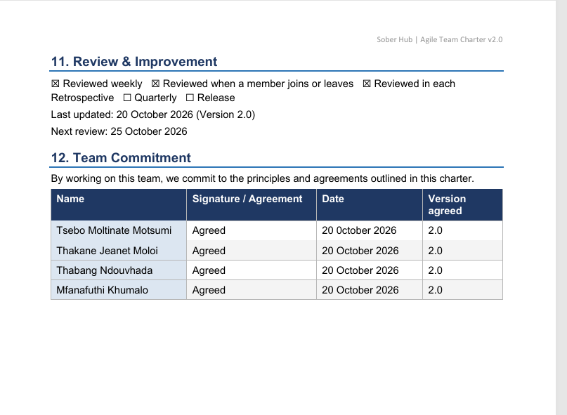
      </a>
      
<strong>Evidence 11</strong> Additional charter evidence

    </td>
    <td width="50%" align="center">
      
Additional supporting documentation is available below.

    </td>
  </tr>
</table>

  <strong>Complete Team Charter:</strong>
  <a href="Agile_Team_Charter/Sober_Hub_Agile_Team_Charter_v2.pdf">
    View Agile Team Charter PDF
  </a>

## Reflection on Agile Team Charter
**Situation:**
We created our first team charter on 1st May 2026 to establish shared working agreements for the Sober Hub project. As the project progressed, I recognised that some roles and communication expectations needed to be clarified.

**Task:**
As team leader, I needed to review the charter and ensure that it reflected our actual working practices and could accommodate new members.

**Action:**
I reviewed the original charter against my Agile Logbook, identified gaps in role allocation and communication, and helped revise the document. Version 2.0 clarified our Scrum and Kanban practices, team responsibilities, communication expectations, accountability and Definition of Done.

**Result:**
 The revised charter provides clearer guidance for
teamwork and gives members a shared reference for expectations
and responsibilities.

**Learning:**
I learnt that a team charter should be reviewed as a project develops rather than created once and forgotten. In future projects, I would review the charter early and revisit it during retrospectives.

**How this connects to sober Hub:**
A project designed to promote trust, safety and consistent support should be developed by a team that practises respect, transparency and accountability.

---

## 2. User Stories and Tasks
## Introduction
A user story describes a feature from the end user's point of view ("As a ..., I want ..., so that ..."). Each story is then broken into smaller tasks the team can complete and tick off. I include this section to show how the Sober Hub idea was turned into work the team could build and track.

  These screenshots show the user stories and development tasks
  managed during the Sober Hub project. They provide evidence of
  task planning, checklist completion and progress tracking.

<table>
  <tr>
    <td width="50%" align="center">
      <a href="User_Stories_And_Tasks/User1_day3.png">
        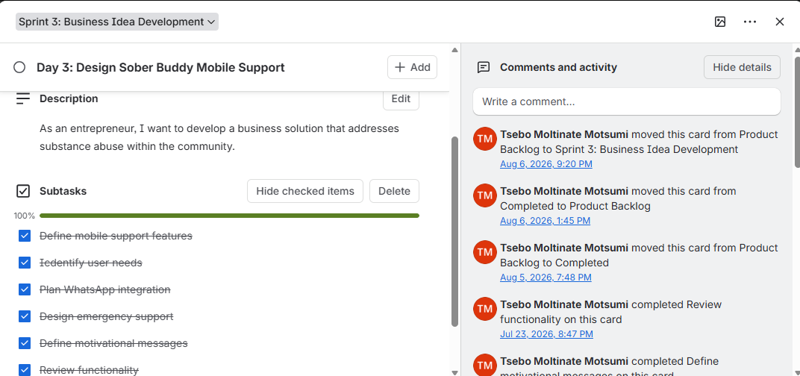
      </a>
      
<strong>Evidence 1</strong> User story and task tracking

    </td>
    <td width="50%" align="center">
      
      
<strong>Evidence 2</strong> Task planning

    </td>
  </tr>
  <tr>
    <td width="50%" align="center">
      
      
<strong>Evidence 3</strong> User story evidence

    </td>
    <td width="50%" align="center">
      
      
<strong>Evidence 4</strong> Development tasks

    </td>
  </tr>
  <tr>
    <td width="50%" align="center">
      
      
<strong>Evidence 5</strong> Task progress

    </td>
    <td width="50%" align="center">
      
      
<strong>Evidence 6</strong> Checklist evidence

    </td>
  </tr>
  <tr>
    <td width="50%" align="center">
      
      
<strong>Evidence 7</strong> Task allocation

    </td>
    <td width="50%" align="center">
      
      
<strong>Evidence 8</strong> Task updates

    </td>
  </tr>
  <tr>
    <td width="50%" align="center">
      
      
<strong>Evidence 9</strong> User story progress

    </td>
    <td width="50%" align="center">
      <a href="User_Stories_And_Tasks/User10_day11.png">
        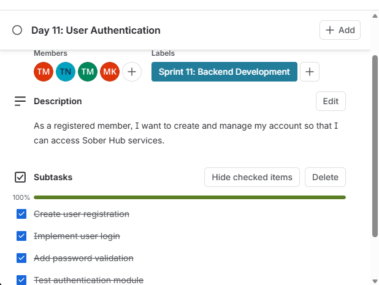
      </a>
      
<strong>Evidence 10</strong> Task update and activity

    </td>
  </tr>
  <tr>
    <td width="50%" align="center">
      
      
<strong>Evidence 11</strong> Development task evidence

    </td>
    <td width="50%" align="center">
      <a href="User_Stories_And_Tasks/User12_day8.png">
        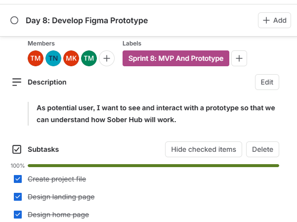
      </a>
      
<strong>Evidence 12</strong> Task tracking and progress

    </td>
  </tr>
</table>

## Reflection on User Stories and Tasks
**Situation:**
After the lecturer approved our business idea, we had to turn Sober Hub into something we could design and build, working in short sprints on Trello.

**Task:**
I needed to describe what our users (young people in recovery, parents and community members) need, and then spilt that into small tasks the team could finish and tick off.

**Action:**
We organised the work into cards with checklists, for example the survey cards in Sprint 2 and the website page cards in Sprint 10 (Landing Page, Membership, Sober Buddy, Skills Labb, Contact, Dashboard and Responsive Design). I wrote the user stories to explain why each page exists, not only what to build. Along the way we changed approach when the lecturer advised moving the wireframes from HTML to Figma.

**Result:**
Sprints 1 to 3, 5-9 were completed with all the checklist items ticked, and the website was presented on 4 August 2026.

**Learning:**
I learnt that a task list alone does not explain who the feature is for; the user story keeps the design focused on the person using it. I also noticed that every card on our board is assigned to all four members, which makes it hard to see who did what. next time I would assign each card or checklist item to one named owner and add acceptance criteria to every story but since Trello needed me to pay for that member assign task next time I will be more prepared and adhere to every rule.

**How this connects to Sober Hub:**
Our users are vulnerable young people, so every page has to be simple, welcoming and easy to use on a phone. Writing stories from their point of view, such as the Sober Buddy support story, kept the design focused on their needs.

---

## 3. Product Backlog
## Introduction
The Product backlog is the ordered list of everything still to be build or improved. it changes whenever feedback arrives. I include it to show what remained to be done and how our priorities evolved.

  The Product Backlog records the features and tasks identified
  for the Sober Hub project. It supports prioritisation and helps
  the team organise the work required to develop the solution.

  

  <strong>Evidence 1:</strong> Product Backlog showing development
  cards and planned project tasks.

My Agile Logbook shows how the backlog changed week by week as feedback came in:
  
### Product Backlog – Weekly Activities

<table>
  <thead>
    <tr>
      <th>Week</th>
      <th>Main Product Backlog Items (from my logbook)</th>
    </tr>
  </thead>
  <tbody>
    <tr>
      <td>14–17 July</td>
      <td>Implement lecturer feedback that requires team discussion; decide presentation responsibilities; and finalise the presentation.</td>
    </tr>
    <tr>
      <td>21–24 July</td>
      <td>Prepare wireframes for the Sober Hub application/website; refine presentation slides; and prepare for lecturer review.</td>
    </tr>
    <tr>
      <td>28–31 July</td>
      <td>Improve wireframes based on feedback; finalise Figma wireframes; and begin frontend development.</td>
    </tr>
    <tr>
      <td>4–7 August</td>
      <td>Fix the application logo; complete Sprint Boards; finalise the Brand Guide; and divide tasks for the following week.</td>
    </tr>
  </tbody>
</table>

## Reflection on Product Backlog
**Situation:**
The backlog began with research and presentation work and grew into design and development as the lecturer gave feedback on each presentation.

**Task:**
I had to keep the backlog current and make sure the most important items were ready to move into a sprint.

**Action:**
After each presentation I turned the lecturer's comments into backlog items. For example, feedback on 28 July led us to rebuild the wireframes in Figma (now the "Develop Figma Prototype" card) and start the frontend, and feedback on 4 August added the logo fix. When a sprint started, the cards were moved out of the Product backlog into that sprint.

**Result:**
The backlog moved from presentation slides, to wireframes, to a working website, top the Brand Guide and Sprint Boards. The remaining items are the unfinished pages and the Figma prototype.

**Learning:**
I learnt that a backlog is never finished and must be reordered when feedback arrives. I also learnt that the highest-priority work should sit at the top. next time I would add a priority label (must-have, should-have, could-have) and a due date to every backlog card.

**How this connects to Sober Hub:**
Sober Hub has to respond to what the community needs. Reordering the backlog after each round of feedback follows the sample principle: listen, adjust, and deliver the most valuable features first.

---

## 4. Sprint Backlog
## Introduction
A Sprint Backlog is the set of backlog items the team commits to finishing in one sprint, with the tasks needed to do it. I included it to show how the project was divided into focused phases of work.

 

  The following screenshots provide evidence of the Sprint Backlog
  for the Sober Hub project. They demonstrate how development
  tasks were organised, tracked and managed during the project.

<table>
  <tr>
    <td align="center" width="50%">
      <a href="Sprint_Backlog/FinalSprint_1.png">
        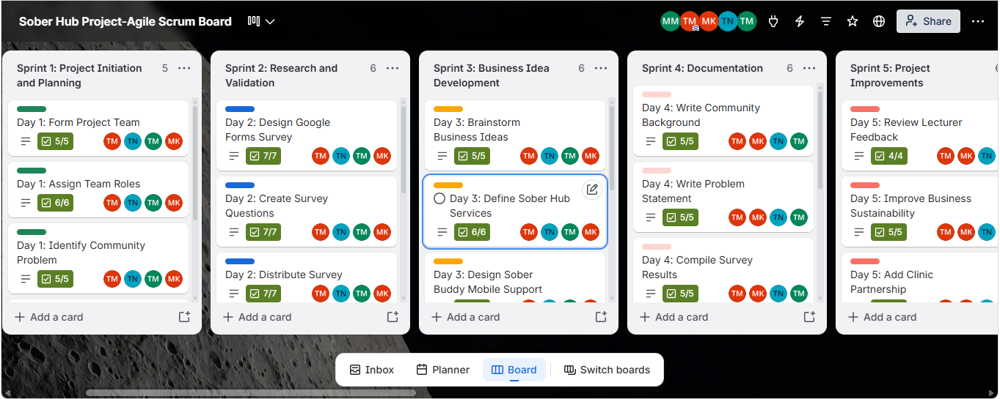
      </a>
      

        <strong>Evidence 1: Sprint Backlog</strong> 
        First Sprint Backlog screenshot.
      

    </td>

    <td align="center" width="50%">
      <a href="Sprint_Backlog/FinalSprint_2.png">
        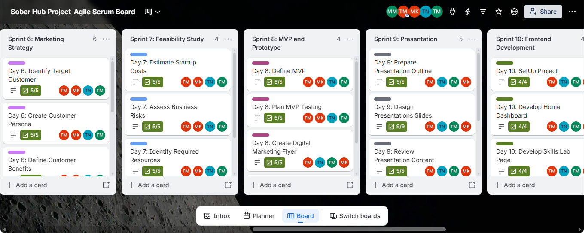
      </a>
      

        <strong>Evidence 2: Sprint Backlog</strong> 
        Second Sprint Backlog screenshot.
      

    </td>
  </tr>

  <tr>
    <td align="center" colspan="2">
      <a href="Sprint_Backlog/FinalSprint_3.png">
        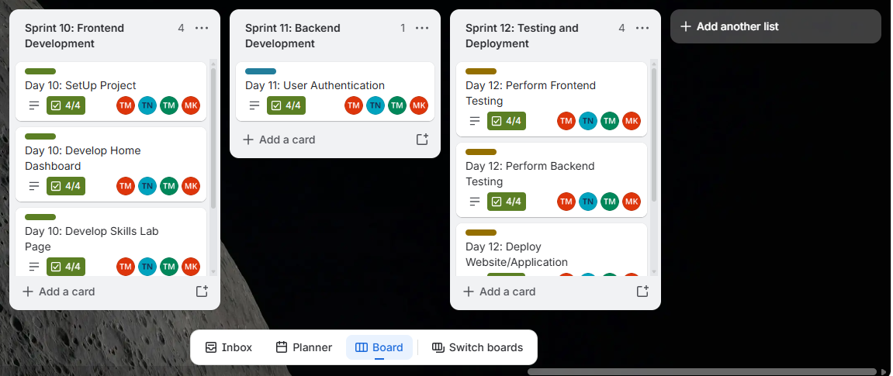
      </a>
      

        <strong>Evidence 3: Sprint Backlog</strong> 
        Additional Sprint Backlog screenshot.
      

    </td>
  </tr>
</table>

  <em>
    These screenshots form part of the project evidence showing
    the planning and organisation of Sober Hub development tasks.
  </em>

## Reflection on Sprint Backlog
**Situation:**
Our Trello board divides the project into 12 sprints, from planning and research through to development and testing. Sprint Boards had to be completed and presented at short notice on 6 August (I only learnt on 5 August that they were due the next day).

**Tasks:**
Make sure each sprint had a clear theme and a manageable set of cards, present the boards, and then divide the following week's tasks among the team.

**Action:**
I completed and practised the Sprint Board presentation, presented on 6 August, noted the lecturer's feedback, and on the 7th August the team divided the next week's work. Each card has a checklist so progress is visible, for example 4/4 on every Sprint 10 card.

**Result:**
Sprints 1 to 10 show completed checklists, and the Sprint Boards and Brand Guide were presented without major issues. Sprint 11 has one card (User Authentication, 4/4) and Sprint 12 (Testing and Deployment) the cards have been updated.

**Learning:**
I learnt that sprints work best when each one has a single theme and small, checkable tasks, and that the plan only helps if everyone can see who owns what. I also learnt to manage my time when several deliverables fall close together. Next time I would plan each sprint at the start of the week, give every card a named owner and due data, and plan the last sprints (testing and deployment) earlier.

**How this connects to Sober Hub:**
Recovery is made of small, consistent steps. Our sprints do the same for the project: short, focused cycles that move Sober Hub forward each week.

---

## 5. Agile Logbook
## Introduction
My Agile Logbook records my daily stand-ups (what I completed, what I plan to do, and what is blocking me), plus a Taskboard and a Walkthrough each week. It shows my day-to-day contribution and how the project progressed from 14 July to 7 August 2026.

  The following screenshots provide visual evidence of my
  activities, contributions and progress during the Sober Hub
  project. They document project planning, design activities,
  frontend development, teamwork and project improvements.

<table>
  <tr>
    <td align="center" width="50%">
      <a href="Agile_Logbook/Agile1.png">
        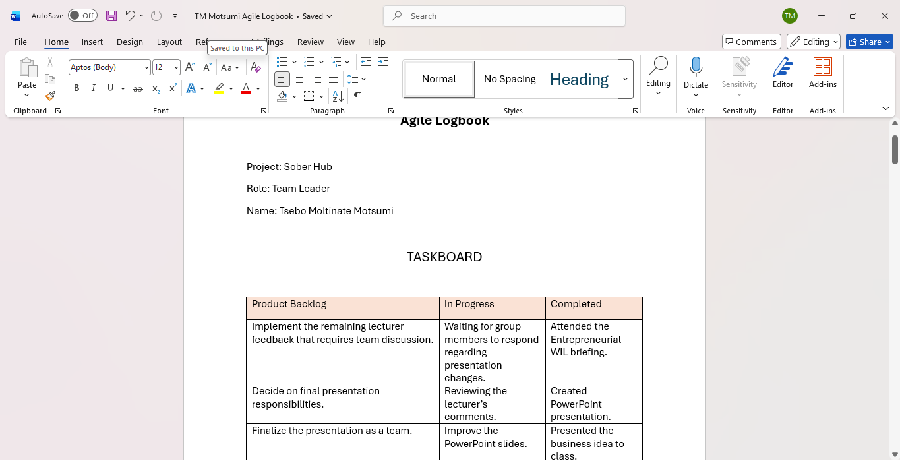
      </a>
      
<strong>Evidence 1: Agile Logbook</strong>

    </td>
    <td align="center" width="50%">
      <a href="Agile_Logbook/Agile2.png">
        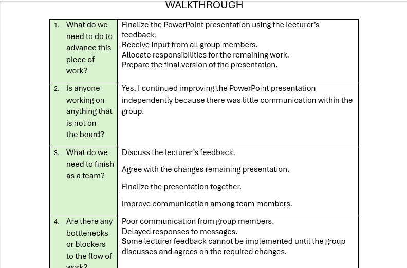
      </a>
      
<strong>Evidence 2: Agile Logbook</strong>

    </td>
  </tr>

  <tr>
    <td align="center" width="50%">
      <a href="Agile_Logbook/Agile3.png">
        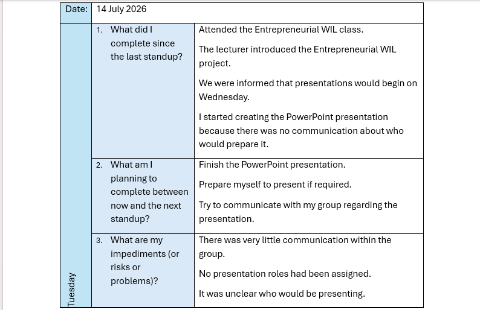
      </a>
      
<strong>Evidence 3: Agile Logbook</strong>

    </td>
    <td align="center" width="50%">
      <a href="Agile_Logbook/Agile4.png">
        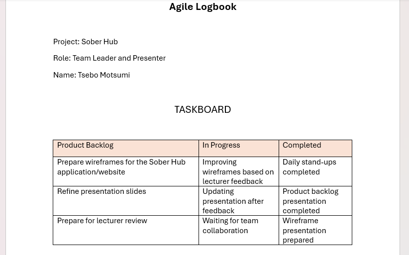
      </a>
      
<strong>Evidence 4: Agile Logbook</strong>

    </td>
  </tr>

  <tr>
    <td align="center" width="50%">
      <a href="Agile_Logbook/Agile5.png">
        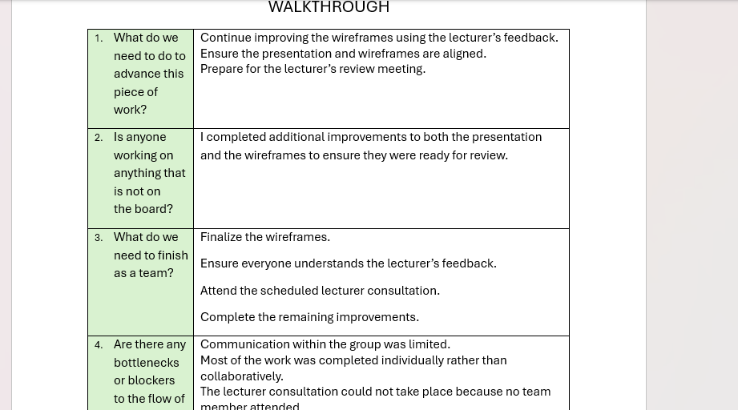
      </a>
      
<strong>Evidence 5: Agile Logbook</strong>

    </td>
    <td align="center" width="50%">
      <a href="Agile_Logbook/Agile6.png">
        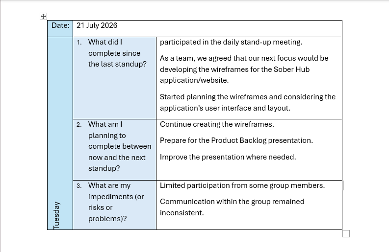
      </a>
      
<strong>Evidence 6: Agile Logbook</strong>

    </td>
  </tr>

  <tr>
    <td align="center" width="50%">
      <a href="Agile_Logbook/Agile7.png">
        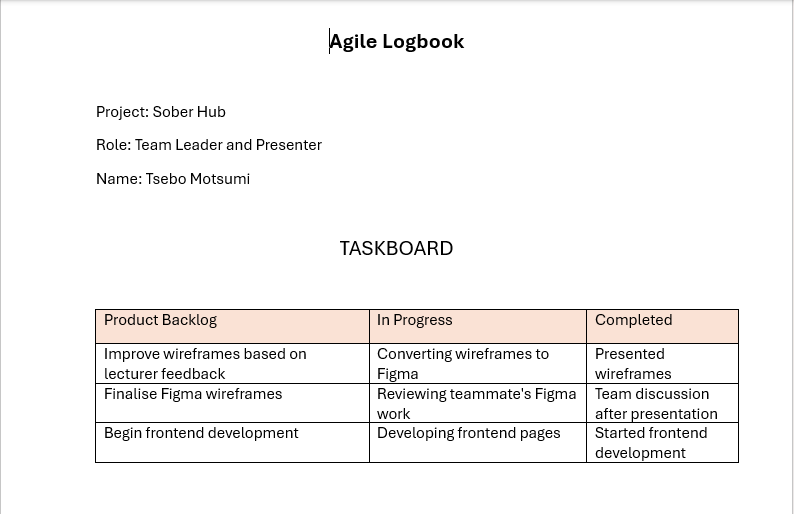
      </a>
      
<strong>Evidence 7: Agile Logbook</strong>

    </td>
    <td align="center" width="50%">
      <a href="Agile_Logbook/Agile8.png">
        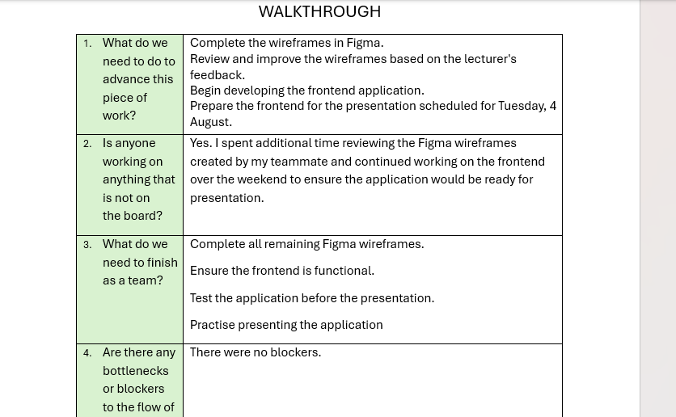
      </a>
      
<strong>Evidence 8: Agile Logbook</strong>

    </td>
  </tr>

  <tr>
    <td align="center" width="50%">
      <a href="Agile_Logbook/Agile9.png">
        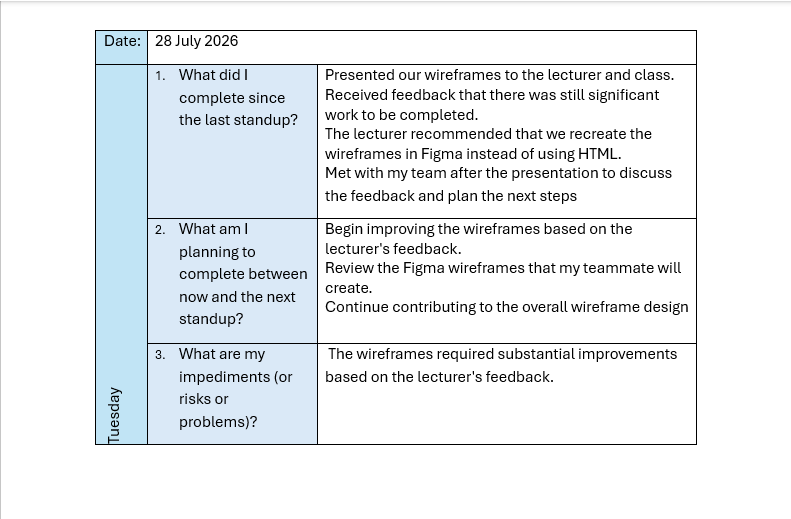
      </a>
      
<strong>Evidence 9: Agile Logbook</strong>

    </td>
    <td align="center" width="50%">
      <a href="Agile_Logbook/Agile10.png">
        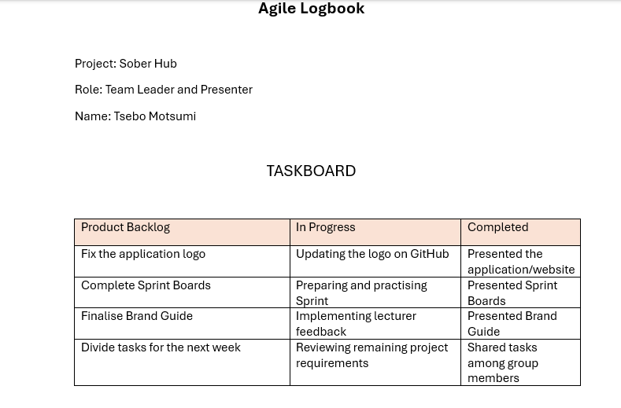
      </a>
      
<strong>Evidence 10: Agile Logbook</strong>

    </td>
  </tr>

  <tr>
    <td align="center" width="50%">
      <a href="Agile_Logbook/Agile11.png">
        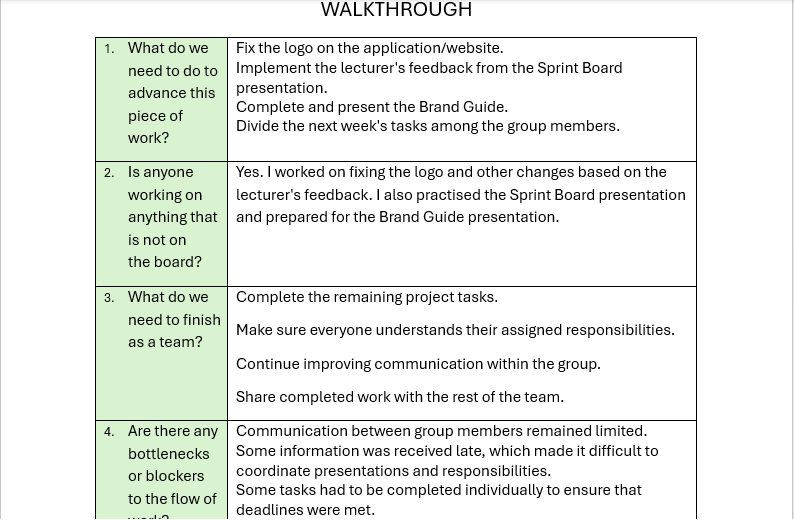
      </a>
      
<strong>Evidence 11: Agile Logbook</strong>

    </td>
    <td align="center" width="50%">
      <a href="Agile_Logbook/Agile12.png">
        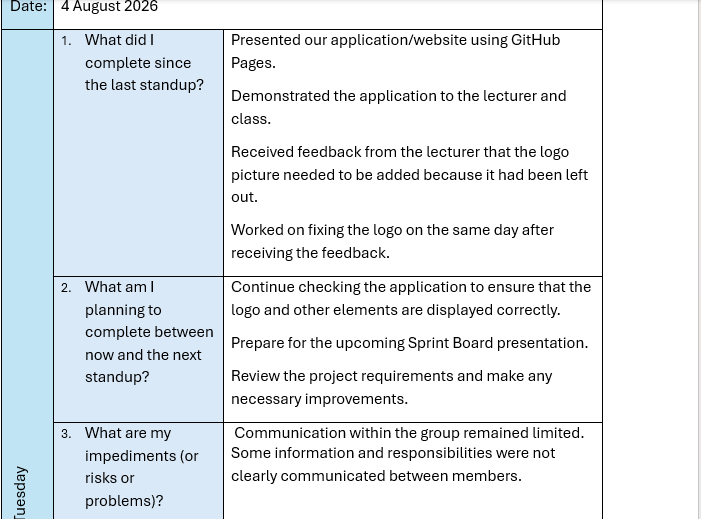
      </a>
      
<strong>Evidence 12: Agile Logbook</strong>

    </td>
  </tr>
</table>

<h3>Supporting Documents: Weekly Agile Logbooks</h3>

  The following PDF documents provide the complete weekly
  Agile Logbook records that support the screenshots above.
  They contain additional details about project activities,
  progress, feedback and learning throughout the Sober Hub project.

<ul>
  <li>
    <strong>Week 1 (14–17 July):</strong>
    <a href="Agile_Logbook/Week1_14-17_July.pdf">
      View Week 1 Agile Logbook (PDF)
    </a>
  </li>
  <li>
    <strong>Week 2 (21–24 July):</strong>
    <a href="Agile_Logbook/Week2_21-24_July.pdf">
      View Week 2 Agile Logbook (PDF)
    </a>
  </li>
  <li>
    <strong>Week 3 (28–31 July):</strong>
    <a href="Agile_Logbook/Week3_28-31_July.pdf">
      View Week 3 Agile Logbook (PDF)
    </a>
  </li>
  <li>
    <strong>Week 4 (4–7 August):</strong>
    <a href="Agile_Logbook/Week4_04-07_July.pdf">
      View Week 4 Agile Logbook (PDF)
    </a>
  </li>
</ul>

## Progress timeline from my logbook

<table>
  <thead>
    <tr>
      <th>Date</th>
      <th>Milestone</th>
    </tr>
  </thead>
  <tbody>
    <tr>
      <td>14–15 July</td>
      <td>Attended the Entrepreneurial WIL briefing, created the PowerPoint presentation, presented the business idea, and received lecturer feedback.</td>
    </tr>
    <tr>
      <td>16–17 July</td>
      <td>Reviewed the lecturer's feedback and improved the presentation.</td>
    </tr>
    <tr>
      <td>21–22 July</td>
      <td>Agreed to develop wireframes and presented the Product Backlog to the lecturer.</td>
    </tr>
    <tr>
      <td>24 July</td>
      <td>Completed improvements in preparation for the lecturer consultation.</td>
    </tr>
    <tr>
      <td>28 July</td>
      <td>Presented the wireframes. The lecturer advised the team to recreate them in Figma.</td>
    </tr>
    <tr>
      <td>31 July</td>
      <td>Received instructions to begin frontend development and started working on the frontend.</td>
    </tr>
    <tr>
      <td>4 August</td>
      <td>Presented the website hosted on GitHub Pages and fixed the missing application logo on the same day.</td>
    </tr>
    <tr>
      <td>6 August</td>
      <td>Presented the Sprint Board and Brand Guide.</td>
    </tr>
    <tr>
      <td>7 August</td>
      <td>Divided the team's tasks for the following week.</td>
    </tr>
  </tbody>
</table>

## Reflection on Agile Logbook
**Situation:**
Over four weeks I recorded daily stand-ups while the project moved from presentation, to wireframes, to a website, to Sprint Boards and a Brand Guide.

**Task:**
Keep an honest, up-to-date record and use it to spot problems early.

**Action:**
I completed my daily stand-up each day and answered the weekly Walkthrough questions. The logbook showed a recurring blocker; communication. Messages were sometimes late, and several tasks had to be done by me individually. I responded by taking initiative (for example creating the PowerPoint on 14 July, and continuing the frontend over the weekend before the 4 August presentation), by asking teammates to attend a consultation I could not attend, and by proposing clearer communication and accountability rules in Charter Version 2.0.

**Result:**
The logbook gave me evidence to improve the team's working agreements and showed steady delivery: presentations, wireframes, website, Sprint Boards and Brand Guide were all presented.

**Learning:**
I learnt that stand-ups work when everyone takes part, and that a leader has to balance doing the work with enabling the team. I learnt about time management, adapting to feedback (switching to Figma) and the importance of communication. Next time I would confirm important messages were received, share tasks earlier, and rotate presenters so that more members are prepared.

**How this connects to Sober Hub:**
The logbook records the real journey of building Sober Hub, including the setbacks. The same honesty, regular check-in and continuous improvement are what we want Sober Hub to offer young people in recovery.

# 🔗 Connecting it all together
**Collect → Select → Reflect → Connect**. I collected my Agile artefacts (charter, stories, backlogs, sprint boards, logbook), selected the ones that best show my learning, reflected on each, and connected them:

The **Charter:** 
set the rules for how we work.

The **User Stories:** 
defined what Sober Hub should do for its users.

The **Product Backlog:**
held everything the project needed, ordered by priority.

The **Sprint Backlog:** 
broke that work into weekly pieces.

The **Logbook:**
recorded what actually happened each day and showed me where the process needed to improve.

---
